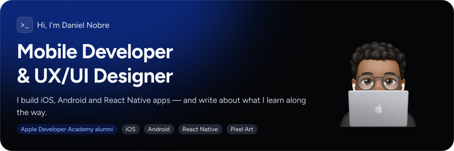
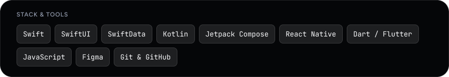
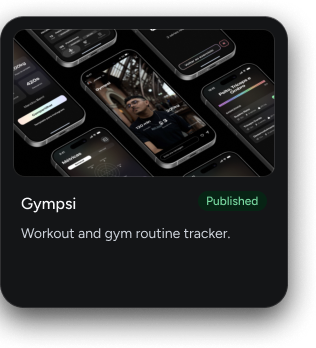
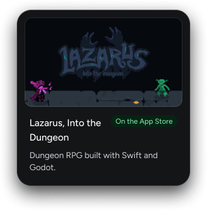
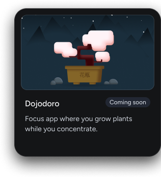
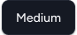
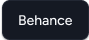
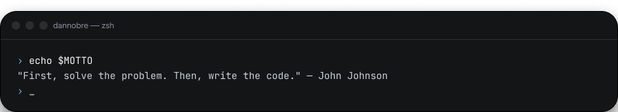

  

### About me

From Fortaleza, Brazil. Computer Science student, Apple Developer Academy alumni and iOS & Android mentor. Off the keyboard: pixel art, anime and the beach. 🌊

  

### Featured projects

  
  
  

### Latest from the blog

Notes on design systems, mobile and what I learn along the way → [dannobre.dev/blog](https://dannobre.dev/blog)

### Let's connect

  
  
  
  

  

  

